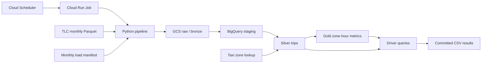

# NYC Taxi Analytics

A small, cost-conscious GCP pipeline for NYC Yellow Taxi data, with January
2023 driver-oriented analysis backed by BigQuery.

## Architecture



The pipeline uses Cloud Run Jobs instead of Dataflow or Dataproc because this
is one sequential monthly file, not a continuous or distributed workload.
BigQuery provides serverless SQL, free batch loads from GCS, and partition
pruning. GCS holds the stable per-month input used for staging; `--force`
refreshes that object. Cloud Scheduler triggers one daily discovery run, while
Cloud Build and Artifact Registry provide a reproducible container without an
always-on server.

All resources are in `us-central1`. The main tables are:

| Layer | Table | Purpose |
|---|---|---|
| Ops | `taxi_ops.monthly_loads` | One row per load, skip, or failed attempt |
| Silver | `taxi_silver.taxi_zones` | Official 265-zone lookup |
| Silver | `taxi_silver.trips` | Source rows, enrichment, and quality issues |
| Gold | `taxi_gold.zone_hour_metrics` | Eligible trip totals by zone, date, and hour |

Silver and gold are partitioned by `source_month`, require a partition filter,
and are clustered by pickup zone and hour. Source times remain NYC local
`DATETIME` values; the source does not provide an offset that supports a safe
UTC conversion.

## Run locally

Requirements: Python 3.12, [`uv`](https://docs.astral.sh/uv/), a GCP project
with billing, and Application Default Credentials with access to the project.

```powershell
gcloud auth application-default login

$env:GCP_PROJECT_ID = "nyc-taxi-analytics-503113"
$env:GCP_PROJECT_NUMBER = "411442366180"
$env:GCP_LOCATION = "us-central1"

uv sync --frozen
uv run nyc-taxi setup
uv run nyc-taxi load --month 2023-01
uv run nyc-taxi export --month 2023-01
```

The other supported operations are:

```powershell
# Explicitly reload and replace one month
uv run nyc-taxi load --month 2023-01 --force

# Check the last three completed calendar months
uv run nyc-taxi discover --lookback-months 3

# Bounded backfill without another CLI command
$cursor = [datetime]"2023-01-01"
$end = [datetime]"2023-12-01"
while ($cursor -le $end) {
    uv run nyc-taxi load --month $cursor.ToString("yyyy-MM")
    $cursor = $cursor.AddMonths(1)
}
```

Every query sets the project and location explicitly and has a 10 GiB
`maximum_bytes_billed` guardrail.

## Incremental and failure behavior

- A successful month is recorded as `SKIPPED` before any download or transform.
  Discovery does not inspect source revisions; use `--force` for a correction.
- Raw files use
  `yellow/source_month=YYYY-MM/yellow_tripdata_YYYY-MM.parquet` in GCS.
- `--force` overwrites that raw object and replaces only the selected silver and
  gold partitions inside one BigQuery transaction.
- The pipeline treats TLC CDN responses 403 and 404 as an unpublished object.
  Discovery records the attempt as `FAILED`, reports `not published`, and
  continues so the next daily run can retry it. Other HTTP, schema, load, and
  SQL errors remain failures and stop the command.
- Missing required analytical columns stop the load. Known optional fee fields
  become typed `NULL`; unrelated new fields are ignored.
- Successfully validated staging tables expire after 24 hours. All source rows
  remain in silver even when they are excluded from gold metrics.

## Data quality

The January file contained 3,066,766 rows. The live pipeline retained all of
them; 2,961,036 rows (96.6%) were analytically eligible and 105,730 (3.4%) had
one or more issues. Individual issue counts overlap.

| Rule | Rows | Share |
|---|---:|---:|
| Pickup outside January | 48 | <0.1% |
| Invalid timestamps | 1,121 | <0.1% |
| Duration outside 1-240 minutes | 36,274 | 1.2% |
| Distance outside 0.1-100 miles | 54,287 | 1.8% |
| Non-positive total | 25,772 | 0.8% |
| No-charge, dispute, or voided payment | 51,320 | 1.7% |
| Missing zone match | 0 | 0.0% |
| Duplicate core trip | 0 | 0.0% |

See the [quality query](src/nyc_taxi/sql/analysis/06_data_quality_summary.sql)
and [January result](results/2023-01/06_data_quality_summary.csv).

## Driver findings

The main metric is **gross receipts per engaged trip hour**:

`SUM(total_amount) / SUM(trip_duration_minutes) * 60`

It is not net income and is not total working-hour earnings. It excludes idle
time, airport queues, empty repositioning, fuel, lease costs, and other
operating expenses.

1. Test late-night LaGuardia pickups. Weekday 01:00 ranked first at $196.60 per
   engaged hour across 615 trips and 20 active days; weekday midnight reached
   $190.53 across 2,781 trips. [SQL](src/nyc_taxi/sql/analysis/01_best_pickup_windows.sql) |
   [CSV](results/2023-01/01_best_pickup_windows.csv)
2. Keep a mix of short and long work. Trips of 10+ miles returned $130.67 per
   engaged hour but represented only 8.1% of eligible trips. Under-two-mile
   trips returned $117.57, while the 2-5 mile band was lowest at $93.93.
   [SQL](src/nyc_taxi/sql/analysis/02_distance_tradeoffs.sql) |
   [CSV](results/2023-01/02_distance_tradeoffs.csv)
3. LaGuardia was the stronger airport sample at $148.79 per engaged hour,
   compared with $128.26 at JFK and $107.34 outside airports. Newark's $288.95
   result came from only 22 trips and is not decision-grade.
   [SQL](src/nyc_taxi/sql/analysis/03_airport_tradeoffs.sql) |
   [CSV](results/2023-01/03_airport_tradeoffs.csv)
4. Do not choose a shift from tips alone. Among credit-card trips, hourly
   recorded tip rates stayed in a fairly narrow 15.9%-17.7% range. TLC states
   that cash tips are not included, so cash trips are not treated as zero tips.
   [SQL](src/nyc_taxi/sql/analysis/04_credit_card_tipping.sql) |
   [CSV](results/2023-01/04_credit_card_tipping.csv)
5. Use destination demand as a repositioning signal. East Elmhurst, JFK,
   LaGuardia, and Penn Station had 8.592, 5.399, 2.833, and 1.632 next-hour
   pickups per drop-off respectively. This ratio can exceed one and is not the
   probability of getting the next fare.
   [SQL](src/nyc_taxi/sql/analysis/05_follow_on_demand.sql) |
   [CSV](results/2023-01/05_follow_on_demand.csv)

The TLC [trip record user guide](https://www.nyc.gov/assets/tlc/downloads/pdf/trip_record_user_guide.pdf)
notes that provider-submitted records are not guaranteed to be accurate. The
[Yellow Taxi data dictionary](https://www.nyc.gov/assets/tlc/downloads/pdf/data_dictionary_trip_records_yellow.pdf)
defines the fields and confirms the cash-tip limitation.

## Deployment

The deployment script requires a clean `main` branch. It intentionally reuses
the existing `nyc-taxi` Artifact Registry repository, dedicated build bucket,
build/runtime/scheduler service accounts and IAM grants, enabled APIs, and
`nyc-taxi-daily` Scheduler job. The `setup` command creates the data plane, not
those deployment prerequisites. The script builds a commit-tagged image,
deploys one non-root task with 1 vCPU and 512 MiB, waits for a successful
execution, updates the HTTP trigger, and resumes scheduling only after
validation.

```powershell
powershell -ExecutionPolicy Bypass -File .\scripts\deploy.ps1
```

The live job is `nyc-taxi-pipeline`. Scheduler job `nyc-taxi-daily` runs at
06:00 `America/New_York` with `discover --lookback-months 3`. The validated
image is commit `3f8bdbf` with digest
`sha256:1d182d8fddc87541b55f28c7925893ae606f0112d51d20b2476d5ffbf38b0039`.

## Cost estimate

Measurements were taken from the rebuilt pipeline in July 2026:

- Three canonical raw files average 60,730,220 bytes, projecting to 3.4 GiB
  for 60 months. The bucket currently uses 219 MiB because one pre-cutover
  January copy is retained temporarily.
- Three lean silver/gold months use 2,993,348,848 logical bytes. A rough linear
  projection from this three-month sample gives 55.8 GiB after five years;
  older partitions qualify for long-term storage pricing after 90 days without
  modification.
- The six January analytical dry runs total 566,432,302 bytes (0.53 GiB). A
  normal January transform billed 1.4 GiB. Daily successful-manifest checks
  keep the expected recurring query volume well below 1 TiB per month.
- The validated daily Cloud Run execution took 97 seconds. Artifact Registry
  currently uses about 0.20 GiB and keeps the latest three images.

| Service | Five-year / monthly assumption | Estimated monthly cost |
|---|---|---:|
| BigQuery storage | 55.8 GiB, with old partitions at long-term rates | $0.70-$1.10 |
| BigQuery queries and batch loads | About 3 GiB queried/month; batch loads are free | $0.00 |
| Cloud Storage | About 3.4 GiB raw | $0.00 |
| Cloud Run Job | One short daily run plus one monthly load | $0.00 |
| Cloud Scheduler | One job | $0.00 |
| Artifact Registry / Cloud Build | Three images; occasional short build | $0.00 |

The practical estimate is **about $1/month**, with **$2/month as a conservative
budget**. Without any billing-account free allowances, the same workload is
roughly $1.20-$1.50/month at current list prices. These allowances are shared
across the billing account and may already be consumed elsewhere. Pricing can
change; see the official pages for [BigQuery](https://cloud.google.com/bigquery/pricing),
[Cloud Storage](https://cloud.google.com/storage/pricing),
[Cloud Run](https://cloud.google.com/run/pricing),
[Cloud Scheduler](https://cloud.google.com/scheduler/pricing), and
[Artifact Registry](https://cloud.google.com/artifact-registry/pricing).

## Validation evidence

- First January lean load: `SUCCEEDED`, 3,066,766 rows.
- Identical rerun: `SKIPPED`, with silver and gold counts unchanged.
- Forced rerun: `SUCCEEDED`, still 3,066,766 silver rows and 66,605 gold rows.
- All six analyses and the monthly transform passed guarded BigQuery dry runs.
- Cloud Build `52f7da08-086a-46cf-8ced-6033f8a71ca1` succeeded.
- Cloud Run execution `nyc-taxi-pipeline-p9qk4` succeeded.
- Scheduler is enabled at `0 6 * * *` in `America/New_York`.

The suite contains 12 focused unit and static SQL-contract tests; live GCP
validation is reported separately above. Run the local checks with:

```powershell
uv sync --frozen
uv run python -m unittest discover -s tests -v
uv run python -m compileall src tests
uv tool run ruff@0.14.14 check .
uv tool run ruff@0.14.14 format --check .
docker build --tag nyc-taxi:local .
docker run --rm nyc-taxi:local --version
docker run --rm --entrypoint /usr/bin/id nyc-taxi:local -u
```

## Limitations

- Results describe January 2023 associations and do not establish causality.
- Engaged time excludes time between fares, queues, breaks, and repositioning.
- There is no driver, shift, fuel, lease, or operating-cost identifier.
- Weather, events, road closures, and traffic conditions are not modeled.
- Zone-hour aggregates hide within-zone variation and may not generalize to
  other months or current fare rules.

## Cleanup

The following commands permanently remove project resources. The backup
dataset and raw/build buckets contain rollback inputs, so delete them only
after acceptance. Keep the project, billing configuration, and APIs unless a
full project teardown is intended.

```powershell
$project = "nyc-taxi-analytics-503113"
$region = "us-central1"

gcloud scheduler jobs delete nyc-taxi-daily --project=$project --location=$region
gcloud run jobs delete nyc-taxi-pipeline --project=$project --region=$region
gcloud artifacts repositories delete nyc-taxi --project=$project --location=$region

bq rm --recursive --force --dataset "$project`:taxi_staging"
bq rm --recursive --force --dataset "$project`:taxi_ops"
bq rm --recursive --force --dataset "$project`:taxi_silver"
bq rm --recursive --force --dataset "$project`:taxi_gold"
bq rm --recursive --force --dataset "$project`:taxi_backup"

gcloud storage rm --recursive "gs://${project}-raw-411442366180"
gcloud storage rm --recursive "gs://${project}-build-411442366180"

foreach ($name in "nyc-taxi-build", "nyc-taxi-pipeline", "nyc-taxi-scheduler") {
    gcloud iam service-accounts delete "${name}@${project}.iam.gserviceaccount.com" --project=$project
}
```
